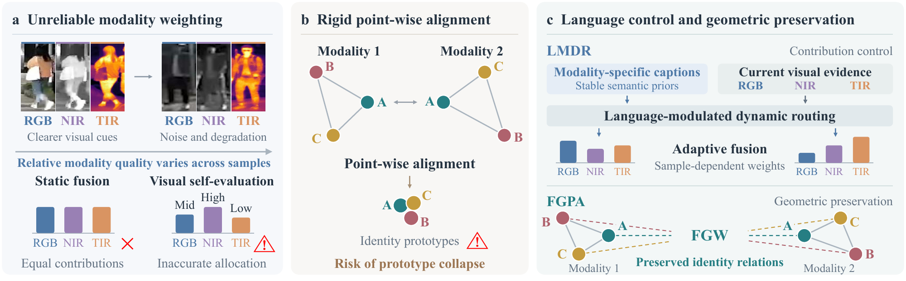
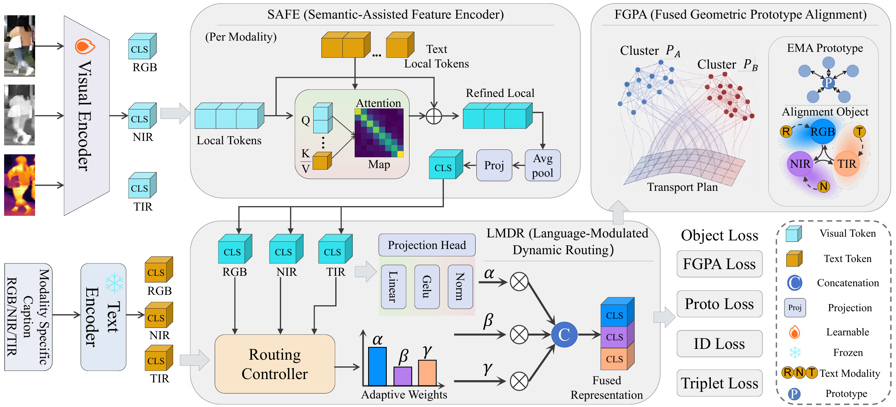

<h1 align="center">LAMP: Language-Modulated Geometric Preservation for Multi-Modal Object Re-Identification</h1>

<p align="center">
  <strong>Shuying Li · Chao Su · Yongxiang Li · Peng Hu · Dezhong Peng · Yuan Sun*</strong>
</p>

<p align="center">Sichuan University · Southwest Jiaotong University</p>

<p align="center">
  <a href="https://github.com/lsyck123n/LAMP">Project Repository</a>
</p>

<p align="center"><sub>* Corresponding author</sub></p>

## Introduction

**LAMP** is a multi-modal object re-identification framework for RGB, near-infrared, and thermal-infrared imagery. It treats language as an explicit control signal that provides stable semantic priors for sample-adaptive modality fusion. To preserve identity-level relations across heterogeneous modalities, LAMP further formulates prototype alignment as a Fused Gromov–Wasserstein problem that jointly considers feature correspondence and relational geometry.

<p align="center">
  
</p>

<p align="center"><em>Motivation of LAMP.</em></p>

## Contents

- [Method](#method)
- [Main Results](#main-results)
- [Datasets](#datasets)
- [Text Annotations](#text-annotations)
- [Reproduction and Release Status](#reproduction-and-release-status)
- [Citation](#citation)
- [Acknowledgements](#acknowledgements)

## Method

<p align="center">
  
</p>

<p align="center"><em>Overview of the LAMP framework.</em></p>

LAMP consists of three components.

- **Semantic-Assisted Feature Encoder (SAFE)** integrates textual semantics into local visual features to obtain discriminative modality-specific representations.
- **Language-Modulated Dynamic Routing (LMDR)** uses language to guide sample-adaptive routing and balance the contributions of RGB, NIR, and TIR features.
- **Fused Geometric Prototype Alignment (FGPA)** aligns identity prototypes through joint feature and relational matching, preserving cross-modal identity geometry.

## Main Results

The following results are reported in the paper. LAMP uses the modality-specific captions released by [IDEA](https://github.com/924973292/IDEA).

| Dataset | Task | mAP | Rank-1 |
| --- | --- | ---: | ---: |
| RGBNT201 | Person ReID | **84.2** | **87.6** |
| RGBNT100 | Vehicle ReID | **89.4** | **98.7** |
| MSVR310 | Vehicle ReID | **59.5** | **74.6** |

All scores are percentages. Evaluation uses the dataset-specific query and gallery protocols, with CMC and mAP as the retrieval metrics.

## Datasets

### Sources and Downloads

| Dataset | Official source | Image download |
| --- | --- | --- |
| RGBNT201 | [Dataset author's page](https://ziwang1121.github.io/publication.html) · [PFNet paper](https://ojs.aaai.org/index.php/AAAI/article/view/16467) | [Google Drive](https://drive.google.com/drive/folders/1EscBadX-wMAT56_It5lXY-S3-b5nK1wH) |
| RGBNT100 | [HAMNet dataset repository](https://github.com/ttaalle/multi-modal-vehicle-Re-ID) | [Baidu Netdisk](https://pan.baidu.com/s/1xqqh7N4Lctm3RcUdskG0Ug), extraction code `rjin` |
| MSVR310 | [CCNet dataset repository](https://github.com/superlollipop123/Cross-directional-Center-Network-and-MSVR310) | [Google Drive mirror provided by IDEA](https://drive.google.com/file/d/1IxI-fGiluPO_Ies6YjDHeTEuVYhFdYwD/view) |

For RGBNT201, download `RGBNT201.zip` from the linked folder. The MSVR310 mirror contains `MSVR310.zip`. Please follow the access conditions specified by the dataset authors.

### Directory Structure

The following image and annotation layout matches the dataset loaders. `datasets` denotes your local data directory.

```text
datasets/
├── RGBNT201/
│   ├── train_171/
│   │   ├── RGB/
│   │   ├── NI/
│   │   └── TI/
│   ├── test/
│   │   ├── RGB/
│   │   ├── NI/
│   │   └── TI/
│   └── text/
├── RGBNT100/
│   └── rgbir/
│       ├── bounding_box_train/
│       ├── query/
│       ├── bounding_box_test/
│       └── text/
└── MSVR310/
    ├── bounding_box_train/
    │   └── <identity>/
    │       ├── vis/
    │       ├── ni/
    │       └── th/
    ├── query3/
    │   └── <identity>/
    │       ├── vis/
    │       ├── ni/
    │       └── th/
    ├── bounding_box_test/
    │   └── <identity>/
    │       ├── vis/
    │       ├── ni/
    │       └── th/
    └── text/
```

- **RGBNT201** uses `train_171` for training and `test` for both query and gallery. Corresponding RGB, NI, and TI images share the same filename.
- **RGBNT100** stores each triplet in one horizontally concatenated JPEG. The loader crops the RGB, NI, and TI regions from left to right, each with a width of 256 pixels and a height of 128 pixels.
- **MSVR310** uses `query3` for queries. Within each identity directory, the `vis`, `ni`, and `th` folders contain corresponding images with matching filenames.

## Text Annotations

The main experiments use the precomputed modality-specific captions released in [IDEA's QwenVL_Anno directory](https://github.com/924973292/IDEA/tree/main/QwenVL_Anno). Prepare the image datasets above and copy the corresponding annotation directories as follows.

| Annotation source in IDEA | Destination in your data directory |
| --- | --- |
| `QwenVL_Anno/RGBNT201/text/` | `RGBNT201/text/` |
| `QwenVL_Anno/RGBNT100/text/` | `RGBNT100/rgbir/text/` |
| `QwenVL_Anno/MSVR310/text/` | `MSVR310/text/` |

Each `text` directory contains six JSON files.

```text
text/
├── train_RGB.json
├── train_NI.json
├── train_TI.json
├── test_RGB.json
├── test_NI.json
└── test_TI.json
```

Each file is a list of records with the following fields.

```json
[
  {
    "item": "<image_filename>.jpg",
    "description": "<modality-specific description>"
  }
]
```

The `item` field must match the image filename, including its extension. Training reads the `train_*` annotations, while query and gallery both read the `test_*` annotations. Keep the RGB, NI, and TI annotation files paired with the corresponding images. The loader constructs modality-specific text inputs from these descriptions and tokenizes them using the bundled CLIP tokenizer.

| Dataset | Image triplets | Text descriptions |
| --- | ---: | ---: |
| RGBNT201 | 4,787 | 14,361 |
| RGBNT100 | 17,250 | 51,750 |
| MSVR310 | 2,087 | 6,261 |

## Reproduction and Release Status

LAMP is implemented in PyTorch. The experiments reported in the paper were conducted on a single NVIDIA GeForce RTX 4090 GPU.

The public repository currently contains the project README. Source code and trained LAMP checkpoints have not yet been released.

## Citation

If you find this work useful, please consider citing it.

```bibtex
@misc{li2026lamp,
  title={LAMP: Language-Modulated Geometric Preservation for Multi-Modal Object Re-Identification},
  author={Li, Shuying and Su, Chao and Li, Yongxiang and Hu, Peng and Peng, Dezhong and Sun, Yuan},
  booktitle={Advances in Neural Information Processing Systems},
  year={2026}
}
```

## Acknowledgements

We thank the authors of [DeMo](https://github.com/924973292/DeMo), [IDEA](https://github.com/924973292/IDEA), and [CLIP](https://github.com/openai/CLIP), as well as the RGBNT201, RGBNT100, and MSVR310 dataset authors, for their contributions and shared resources.
